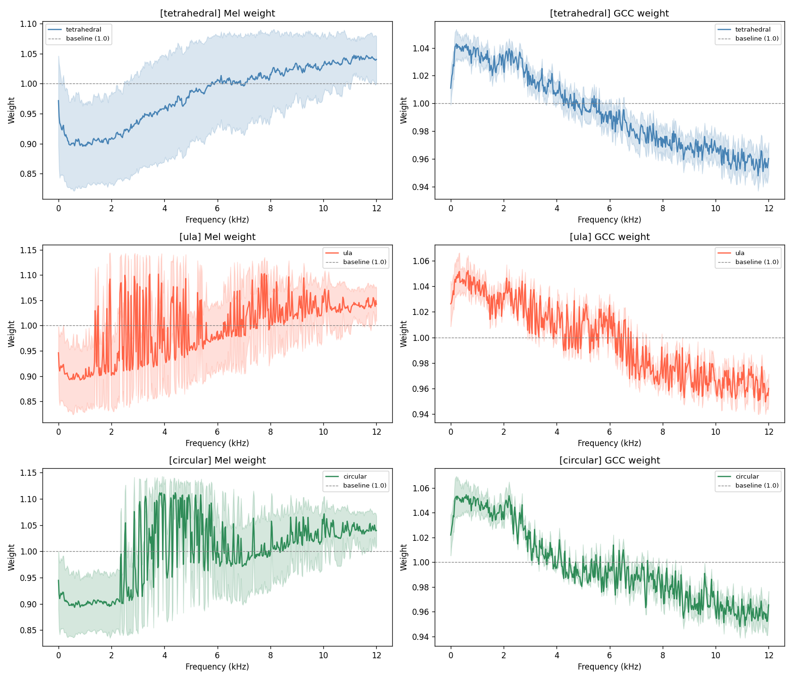
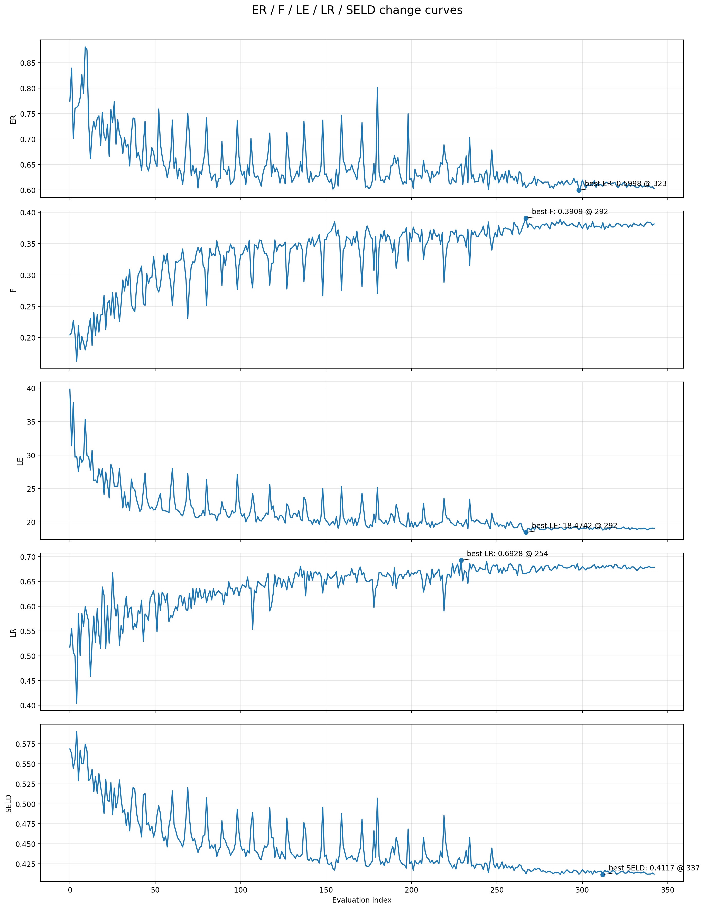

# Frequency-Adaptive Auditory Frontend for Microphone-Domain Sound Event Localization and Detection (FAAF)

**IEEE MLSP 2026** | **Eojin Kim and Sungbin Im** | Soongsil University

[Research portfolio](https://github.com/eojinnn/Research-portfolio) | [Related acoustic localization research (ICTCA 2025)](https://github.com/eojinnn/ICTCA2025)

A **frequency-adaptive acoustic frontend** for microphone-domain sound event localization and detection (**SELD**) that integrates spectral and spatial cues according to their frequency-dependent relevance.

## Research motivation

Microphone-domain SELD often concatenates **multichannel log-mel spectrograms** and **GCC-PHAT** features, leaving their interaction largely to the backend model. However, the relative reliability of spectral and inter-channel timing cues can vary across frequency regions.

**FAAF** introduces an auditory-inspired frequency prior together with learned, signal-dependent weighting so that the two feature branches are balanced during **feature extraction**, without requiring changes to the SELD backend.

## Proposed approach

**Multichannel audio → shared STFT → signal-dependent frequency statistics → prior-guided weighting → weighted log-mel + GCC-PHAT → SELD backend**

1. **Extract complementary cues:** Multichannel log-mel represents spectral information; GCC-PHAT captures inter-channel delay-related spatial structure.
2. **Condition on the signal:** Summarize spectral power, inter-channel coherence, and spectral variation at each frequency.
3. **Modulate an auditory-inspired prior:** Generate frequency-wise weights for the two branches. The paper evaluates **Gated Prior Modulation (GPM)** and **FiLM-based Prior Modulation (FiLM-PM)**.
4. **Reuse existing backends:** Apply the same frontend concept with **ResNet-Conformer** and **CST-Former**.

The reported analysis finds a learned change in relative branch emphasis around **1.5 kHz** (compared with a **6 kHz** initial prior transition): GCC-PHAT tends to have greater relative emphasis in lower-frequency regions, while log-mel becomes more dominant at higher frequencies. This is a qualitative alignment with spatial-hearing motivation, not a hard frequency cutoff.

## Published experimental results

**Dataset:** STARSS23 development test split; training uses STARSS23 dev-train together with synthetic spatial audio built using FSD50K.

**Overall SELD score** (lower is better; mean ± standard deviation over two random seeds), as reported in the IEEE MLSP 2026 paper:

| Frontend | ResNet-Conformer ↓ | CST-Former ↓ |
| --- | ---: | ---: |
| Standard mel + GCC-PHAT | 0.4244 ± 0.0023 | 0.4705 ± 0.0134 |
| FAAF with FiLM-PM | 0.4137 ± 0.0081 | 0.4664 ± 0.0042 |
| **FAAF with GPM** | **0.4103 ± 0.0048** | 0.4686 ± 0.0077 |

The reported performance gain is **more pronounced under ResNet-Conformer**. With CST-Former, the overall score improves modestly while individual metric changes are mixed; the README does not claim uniform improvement in every metric.

## Code overview

This repository contains the research implementation, experiment variants, data-preparation utilities, and supplementary plots. Several files reflect later explorations; **not every model version or experiment configuration corresponds to the published FAAF setup**.

| Path | Description |
| --- | --- |
| [models/my_model15.py](models/my_model15.py) | Auditory frontend with frequency priors and learned weighting, used by \`train_B.py\` |
| [train_B.py](train_B.py) | ResNet-Conformer research training entry point importing \`my_model15\` |
| [models/](models/) | Backbone components and additional research model variants |
| [config/](config/) | Experiment-specific YAML configurations, including \`my_experiment15.yaml\` |
| [reproduce_frontend_weights.py](reproduce_frontend_weights.py) | Script for visualizing frontend weights from an **existing compatible checkpoint** |
| [utils/cls_tools/](utils/cls_tools/) | SELD feature extraction, metrics, and plotting tools |
| [utils/lmdb_tools/](utils/lmdb_tools/) | LMDB packaging utilities |
| [train_A_sedsde.py](train_A_sedsde.py), [config/A_RC_SED-SDE.yaml](config/A_RC_SED-SDE.yaml) | Additional baseline training pathway; **not the FAAF experiment entry point** |

## Preparing the experiment environment

The project uses Python, PyTorch, torchaudio, and additional libraries listed in [requirements.txt](requirements.txt). It also needs appropriate microphone-domain SELD datasets, metadata, feature normalization statistics, and local data preparation.

1. **Set paths** in [utils/cls_tools/parameters.py](utils/cls_tools/parameters.py) before running audio feature extraction.
2. Run the existing feature extraction utility: \`python utils/cls_tools/batch_feature_extraction.py\`.
3. **Configure** the feature/label directories and LMDB output locations in [utils/lmdb_tools/convert_lmdb.py](utils/lmdb_tools/convert_lmdb.py).
4. Review the research configuration (for example, [my_experiment15.yaml](config/my_experiment15.yaml)) to set LMDB paths, reference metadata, normalization file, checkpoint options, and output directories.
5. For the ResNet-Conformer model path wired in \`train_B.py\`, inspect the configuration and launch with:

\`\`\`bash
python train_B.py -c my_experiment15
\`\`\`

**Reproducibility note:** The checked-in configuration includes machine-specific absolute paths and a pretrained-checkpoint flag. Change these to your local paths, and set the checkpoint behavior according to whether you are training or evaluating. The command above describes the code entry point; **it has not been independently tested as an exact reproduction of every published result**. The CST-Former experimental pipeline and the various archived model versions should not be assumed interchangeable with this entry point.

The earlier \`train_A_sedsde.py -c A_RC_SED-SDE\` example invokes a different baseline model and is therefore not presented here as the main FAAF training command.

## Publication

**Eojin Kim and Sungbin Im**, "Frequency-Adaptive Auditory Frontend for Microphone-Domain Sound Event Localization and Detection," *IEEE International Workshop on Machine Learning for Signal Processing (MLSP)*, 2026.

The tables above summarize the **published FAAF experiments**, not necessarily every additional experiment represented in this evolving code archive.
